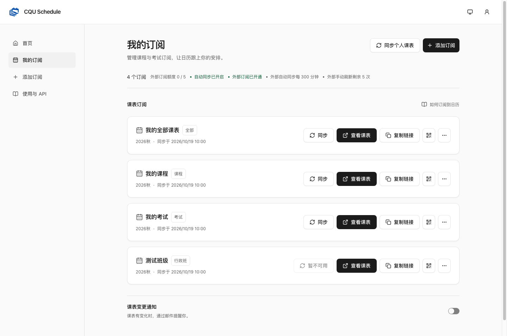
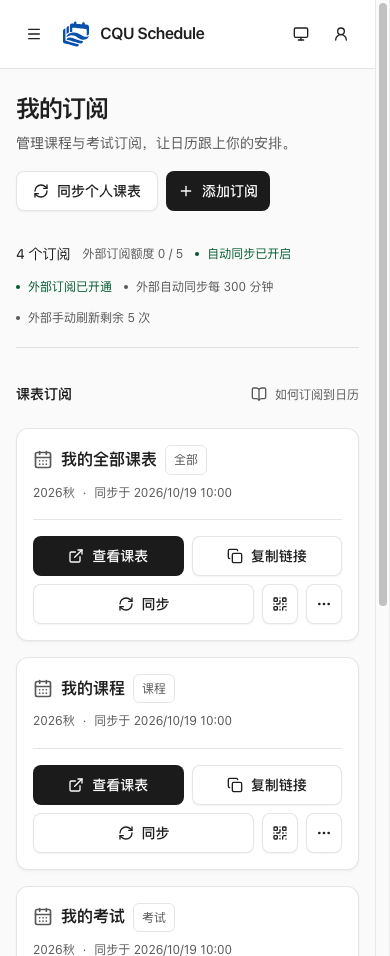

# Subscription action layout

Desktop actions now appear as sync, view schedule, copy link, QR, and more. View and copy use equal columns with a fixed right anchor; a longer sync label grows to their left. Below 1100px, view/copy occupy their own row so sync labels cannot compress them. Loading placeholders follow the same grouping.

Copy uses Lucide Copy, and header/card sync uses RefreshCw via the shared ActionButton API from [design PR #16](https://github.com/cqu-moe/design/pull/16). Shared loading, success, error and disabled behavior is retained.

## Verification

- Before: desktop view/copy widths were 104px/114px. After: 114px/114px.
- Frontend build, design rules and all 274 frontend tests passed.
- The existing Chromium layout test covers 11 viewport/theme/motion/scrollbar combinations. View/copy x positions and widths remain unchanged throughout a mocked sync request and its five-minute cooldown (maximum change: 0px).
- Inspected 320/390/768/1440 screenshots in both themes; no page overflow. QR/menu/dialog focus restoration and scroll unlock checks pass.
- Synthetic API responses only; no real backend writes. Physical devices, screen readers and Firefox/WebKit were not checked.

## Desktop

## Mobile

